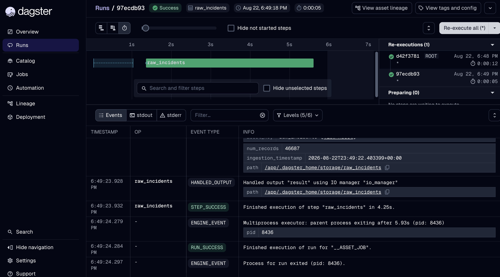

# Minneapolis public-safety

Dagster pipeline that pulls Minneapolis police incidents from the official Open Data API, cleans them, and writes Parquet locally.

Flow: `raw_incidents` → `processed_incidents` → `enriched_incidents`, joined with Minneapolis communities and Metro Council place designations. Schedule: every 6 hours.

```bash
make setup
make materialize
make preview
```

UI: http://127.0.0.1:3000. Enable the 6-hour schedule there. Data lands in `data/raw` and `data/processed`. Asset metadata includes a before/after sample.

`make down` stops containers. `make logs` tails output. API settings live in `.env`.


